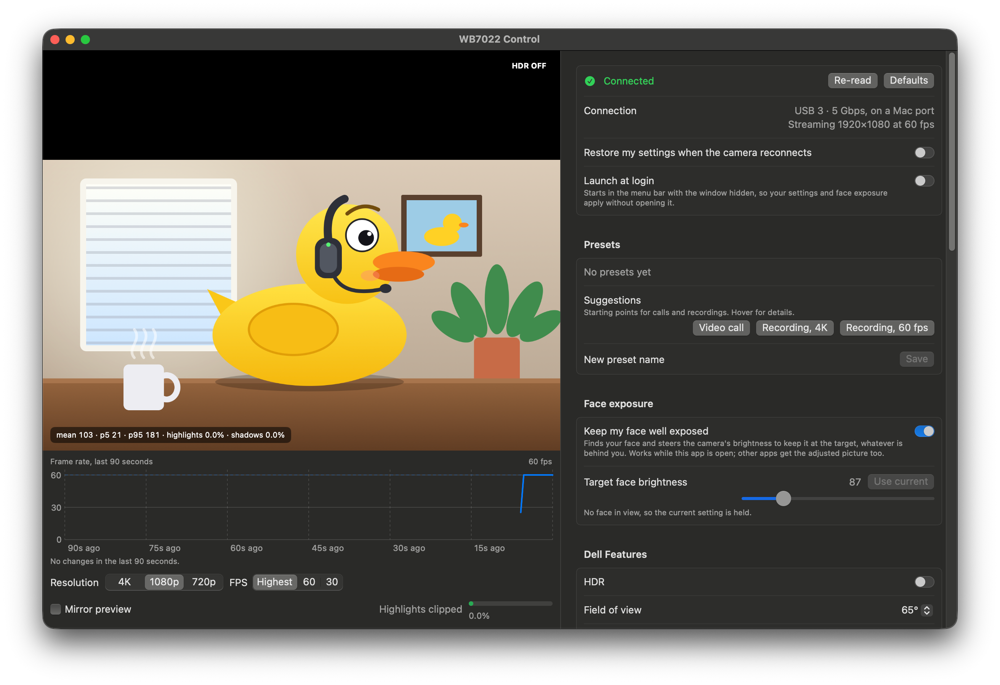

# WB7022 Control

A native macOS app for controlling the Dell UltraSharp WB7022 webcam: HDR, field of view, AI auto framing, and all the standard image and exposure controls, with a live preview.

Not affiliated with or endorsed by Dell. "Dell" and "UltraSharp" are trademarks of Dell Inc.



> [!NOTE]
> **This is a vibe-coded utility for one specific webcam,** the Dell UltraSharp WB7022, and only that camera. Dell's own features (HDR, field of view, AI auto framing) sit behind vendor-specific commands in the camera's USB Video Class (UVC) *extension units*. The app's support for them rests on educated guesses about those commands, tested on a single camera, so expect rough edges.
>
> I made it because I found Dell's own utility, [Dell Display and Peripheral Manager](https://www.dell.com/en-us/shop/software/lp/ddpm), overly obtuse about what was really going on. For most people it's probably not a big improvement on it.
>
> Only tested on macOS 27 (Golden Gate), but it should work on macOS 14 (Sonoma) and later.
>
> DDPM doesn't need to be installed. This app can't update the camera's firmware, though, so you may want DDPM for that.

## Features

- **Dell features:** HDR, field of view (65° / 78° / 90°), AI Auto Framing with framing size, tracking speed and smooth transitions.
- **Image:** brightness, contrast, saturation, sharpness, white balance (auto or manual), anti-flicker with a recommendation for your region.
- **Exposure & focus:** auto exposure, exposure time, gain, low-light frame-rate priority, backlight compensation, autofocus and manual focus.
- **Zoom & framing:** digital zoom up to 5×, pan and tilt.
- **Face exposure:** finds your face and steers the camera's brightness to keep it at a target, so a bright window behind you doesn't leave you dark. Other apps get the adjusted picture too.
- **Suggestions:** one-click starting points for a video call, a 4K recording and a 60 fps recording. Each checks that the camera actually delivers the resolution and frame rate.
- **Presets:** save and load your own named sets of settings.
- **Restore on reconnect:** the camera forgets its settings when unplugged; the app re-applies yours.
- **Live preview** at 4K, 1080p or 720p and 30 or 60 fps, with a highlight-clipping meter and an optional mirrored view.
- **Frame-rate timeline:** the measured frame rate over the last 90 seconds, with a marker for every change the camera accepted.
- **Connection readout:** USB link speed, Mac port or Thunderbolt dock, and the resolution and frame rate actually delivered, with a warning when they fall short.
- **Menu bar extra** with the Dell features, the auto modes, face exposure, suggestions and presets.
- **Launch at login,** starting hidden in the menu bar.

It doesn't take the camera over, so you can change settings while another app is using it.

## Requirements

- macOS 14 or later. Tested only on Apple silicon; the download also runs on Intel Macs, untested.
- The WB7022 on USB 3. Dell's HDR needs it.
- To build: Xcode or the Command Line Tools (Swift 5.9 or later), `xcode-select --install`.

## Install

Download `WB7022-Control.zip` from [Releases](../../releases), unzip it and move the app to Applications.

The app is signed ad hoc, not notarized, so macOS blocks it the first time. Open it once, then click **Open Anyway** in System Settings › Privacy & Security. Or clear the download flag:

```bash
xattr -dr com.apple.quarantine "/Applications/WB7022 Control.app"
```

## Build and run

```bash
./bundle.sh
open "WB7022 Control.app"
```

`./bundle.sh --universal` builds for Apple silicon and Intel in one binary. Pushing a tag such as `v1.2` runs `.github/workflows/release.yml`, which does that, zips the app and publishes a GitHub release. A locally built app isn't marked as downloaded, so Gatekeeper doesn't block it.

The app icon is drawn by `tools/make-icon.swift`; regenerate it with `swift tools/make-icon.swift Resources/AppIcon.icns`.

`bundle.sh` builds with SwiftPM and wraps the binary in `WB7022 Control.app`, signed ad hoc. The signature changes with every build, so macOS asks for camera permission again after each rebuild. Only the preview and face exposure need camera access.

## Good to know

- **HDR applies at stream start.** The app restarts its preview after a toggle; other apps pick it up when they next start video.
- **HDR can band.** It's tone-mapped into 8-bit video, so smooth gradients can show steps. Most rooms look better with it off.
- **Pan and tilt need zoom.** They move a crop window, so they do nothing at 1×.
- **Auto modes don't report their values.** With auto white balance, exposure or focus on, the greyed-out slider shows your own last setting. Gain does nothing under auto exposure.
- **macOS's "4K" preset gives 1080p.** The standard session preset puts this camera in its 1080p mode, on a Mac port and through a dock alike. The app selects the 4K mode directly; in recording apps, pick the resolution explicitly.
- **60 fps needs** 1080p or 720p, auto exposure on (manual runs at about 30 fps) and AI Auto Framing off. With "Allow lower frame rate in low light" on, it may drop to 30 indoors. HDR doesn't affect it.
- **The camera resets the low-light setting** after every resolution or frame-rate change, while still reporting it unchanged. The app re-sends it.
- **Suggestions check this app's preview.** Other apps choose their own resolution and frame rate.
- **Face exposure runs only while the app is open.** Your own brightness comes back when you switch it off.
- **Backlight compensation is not HDR.** It brightens everything and can wash faces out.

## How it works

Standard USB Video Class (UVC) control requests over IOKit (`Sources/CUVC`), without claiming the device, so the system driver and other apps keep working. The camera has a Realtek USB hub built in, so it always shows up behind a hub.

| Unit | Contents |
|---|---|
| 1, Camera Terminal | Auto exposure, exposure time, focus, zoom, pan/tilt |
| 3, Processing Unit | Brightness, contrast, gain, saturation, sharpness, white balance, anti-flicker, backlight compensation |
| 6, Dell extension unit | Dell's command channel (below) |
| 14, Dell extension unit | Further vendor values, not decoded; shown raw in the diagnostics section |

Dell features: write an 8-byte, zero-padded packet to unit 6 selector 1, read the reply from selector 2.

| Packet | Meaning |
|---|---|
| `FF <cmd> [sub] <value, little-endian>` | Set |
| `FE <cmd> [sub]` | Query; reply is the header plus the value |

| Feature | Command | Values |
|---|---|---|
| HDR | `11` | 0 off, 1 on |
| Field of view | `10 01`, 2 bytes | 65, 78, 90 |
| AI Auto Framing | `14 01` | 0 off, 1 on |
| Smooth transitions | `14 10` | 0 off, 1 on |
| Tracking speed | `14 11` | 1 normal, 2 fast |
| Framing size | `14 12` | 1 standard, 2 narrow |

Until the firmware answers, selector 2 echoes the query, which reads as value 0; the app waits briefly before trusting a 0. The protocol was worked out for interoperability from the camera's behaviour and the values Dell's macOS software sends. No Dell code is included.

> **Careful:** units 2 and 6 also hold firmware and debug selectors. Reading unit 6 selector 8 reset the camera. `uvc.c` allows only unit 6 selectors 1–2 at 8 bytes and blocks unit 2. Keep that allowlist.

## Project layout

| Path | Contents |
|---|---|
| `Sources/CUVC/` | Finds the camera (`413C:C015`), sends UVC requests |
| `UVCDevice.swift` | Swift wrapper, payload encoding, Dell send/query |
| `Controls.swift` | Standard UVC controls, mains-frequency table |
| `DellFeatures.swift` | Dell command definitions |
| `Suggestions.swift` | Built-in suggestions, launch at login |
| `CameraModel.swift` | App state, presets, reconnects, face exposure, frame-rate history |
| `CameraFeed.swift` | Capture, format and frame-rate selection, frame statistics |
| `FaceExposure.swift` | Face detection (Vision) and the exposure controller |
| `USBLink.swift` | Link speed and dock detection |
| `Views.swift` | SwiftUI interface |
| `App.swift` | Entry point and diagnostics modes |

Swift files are in `Sources/WB7022Control/`.

## Diagnostics

Hidden modes for development. Run them through `open` so the app, not your terminal, asks for camera access.

```bash
open -W -n "WB7022 Control.app" --args --probe /tmp/probe res:4K selftest
```

`--probe <dir> <steps…>` logs to `<dir>/probe.log` and saves JPEG frames:

| Step | Effect |
|---|---|
| `res:4K` / `1080p` / `720p` | Capture resolution (first step only) |
| `wait:<ms>`, `snap:<name>` | Pause; save a frame with stats |
| `restart` | Restart the stream |
| `format:<w>x<h>`, `fps:<n>`, `fps:highest` | Select a format or frame rate directly |
| `preset:<name>` | Set only the session preset, as most apps do |
| `active` | Log the active format and preset |
| `face:<s>[:<target>]` | Log face brightness; with a target, steer toward it, then restore |
| `selftest` | Set every Dell feature to each value, read back, restore |
| `trace:<hex>` | Send a Dell packet, log replies for 300 ms |
| `<unit>:<sel>:<hex>` | Write a control, read back, save a frame |

Other modes:

| Mode | Effect |
|---|---|
| `--render <png> [--bar] [--focused]` | Draw the controls pane (or, with `--bar`, the chart and preview bar) offscreen |
| `--render <png> --window [--still <image>]` | Draw the whole window, with the image in place of the preview |
| `--suggest <id> <file>` | Apply a suggestion, write its check result, restore all settings |
| `--login-item <on\|off\|status> <file>` | Change or report launch at login |
| `--hidden` | Start hidden, as a login launch does |

## License

MIT. See [LICENSE](LICENSE).
